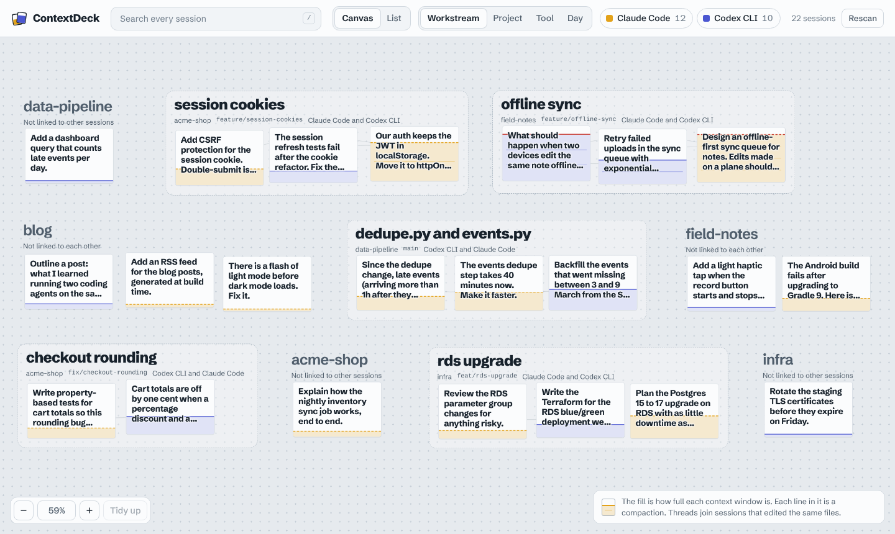
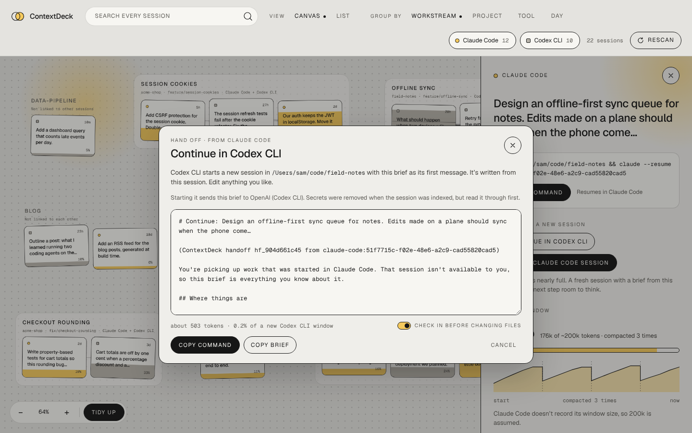
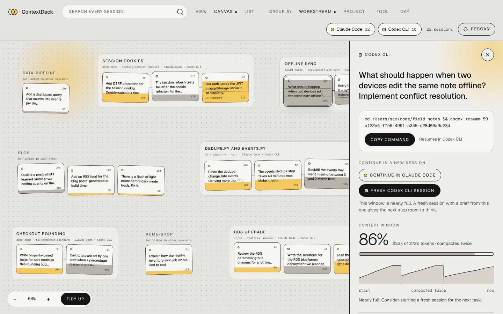

# ContextDeck

**One local index for every AI coding agent session.** Search, organise and resume your context windows across Claude Code, Codex, Qwen Code and more, from one place.

If you use more than one coding agent, your context is scattered: Claude Code keeps sessions per project folder, Codex keeps them per date, and neither knows the other exists. ContextDeck reads them all, puts them in one searchable index on your machine, and links related work across tools.

```bash
contextdeck ui
```



Every session is a card on a canvas. Cards from both tools gather into **workstreams**: sessions that edited the same files or ran on the same feature branch, whichever tool they ran in. Each card **fills up like a glass** to show how full its context window is, with a line for every time it was compacted, and groups that were active in the last hour **glow**. Drag cards wherever you like and ContextDeck remembers, or **Tidy up** into a neat grid. Click one to read it: how its context grew turn by turn, what it changed, what it's related to, and how to jump back in.

**Hand work to another tool.** From any session, choose **Continue in Codex** (or Claude Code), or **Fresh Claude Code session** when a window is nearly full. ContextDeck writes a brief from the session (the goal, your later instructions, where it got to, files changed, recent commands, and how to pick up safely), you read and edit it, and the new session starts in the right folder with the brief as its first message. When it appears, ContextDeck links the two: same workstream, a dashed thread, and "continues this session" in both panels.





Prefer the terminal? Everything is in the CLI too:

```console
$ contextdeck list
ID           TOOL         PROJECT    UPDATED  TURNS    CONTEXT  TITLE
cx:d5e6f701  Codex CLI    acme-shop  13h ago      1  63k (23%)  The session refresh tests fail after the cookie refactor…
cc:0f3a1b11  Claude Code  acme-shop  36h ago      2        44k  Move auth from localStorage tokens to httpOnly session cookies
cc:9e8f7c22  Claude Code  blog       3d ago       1       9.6k  Add an RSS feed for the blog posts, generated at build time.

$ contextdeck related cc:0f3a1b11
Related to cc:0f3a1b11 Move auth from localStorage tokens to httpOnly session cookies
ID           TOOL       UPDATED  WHY            TITLE
cx:d5e6f701  Codex CLI  13h ago  1 shared file  The session refresh tests fail after the cookie refactor…

$ contextdeck resume cx:d5e6f701 --run     # reopens it in Codex, in the right folder
```

> **Status: early (v0.2).** The indexer, CLI and canvas UI work today. Next up: more agents and smarter organisation, see the [roadmap](docs/ROADMAP.md). Contributions are very welcome.

## Principles

- **Local only.** Nothing leaves your machine. No accounts, no telemetry, no network calls.
- **Read only.** Your agents' session files are never modified. The index is a disposable cache; delete it any time.
- **Secrets stripped at the door.** API keys, tokens, passwords and private keys are redacted before anything is indexed.
- **Zero native dependencies.** Built on Node's built-in SQLite, so installing never involves compiling anything.
- **Provider-neutral.** Each tool is a small adapter behind one schema. Adding a new agent touches one file.

## Install

Requires **Node.js 22.13 or newer** (22.15+ to read compressed Codex sessions).

```bash
git clone https://github.com/iamkartiks/context-deck.git contextdeck
cd contextdeck
npm install
npm run build
npm link            # puts `contextdeck` on your PATH
```

Try it on a set of made-up sample sessions first, without touching your real ones:

```bash
npm run demo:ui     # about 20 sample sessions across 5 projects, opens the canvas
```

Then open your own:

```bash
contextdeck doctor  # shows which session folders were found
contextdeck ui      # indexes, then opens the canvas in your browser
```

## The canvas

`contextdeck ui` starts a small server on `127.0.0.1` (port 4977, or the next free one) and opens your browser. Leave it running: it watches your session folders, and new or changed sessions appear on the canvas as your agents work.

| | |
|---|---|
| **Move around** | Drag the background, or scroll. Pinch or ⌘/Ctrl+scroll to zoom. `+` `-` zoom, `0` shows everything. |
| **Arrange** | Drag cards anywhere; positions are saved per grouping. **Tidy up** lines everything up in a grid; **Scatter** goes back to the loose layout with your placements. |
| **Group by** | **Workstream** (linked work across tools), **Project**, **Tool** or **Day**. Threads between cards show sessions that edited the same files. |
| **Search** | Press `/`. The board narrows to matching sessions (searching their full conversations, titles, projects and branches) and zooms to fit them. |
| **Read** | Click a card: context use over the session (real per-turn data, with each compaction marked), files it changed, related sessions in other tools, subagents, and the conversation (tool calls hidden unless you ask). |
| **Resume** | **Copy command**, or **Open in Terminal**, which runs it in a new terminal window in the right folder (see [Windows, macOS and Linux](#windows-macos-and-linux)). |
| **Hand off** | **Continue in…** another tool, or start a **fresh session** in the same one, from a brief you can edit. See [Handoff](#handoff). |
| **List view** | Every session in rows, grouped the same way as the canvas. Handy on small screens. |

Options: `--port <n>`, `--no-open`. The page loads nothing from the internet (fonts are bundled) and only this computer can reach it; see [SECURITY.md](SECURITY.md) for how it's locked down.

Claude Code doesn't record how big its context window is, so its fill level is an **estimate** (200k tokens, or 1M once a session goes past 200k), shown as "~200k" in the side panel. Codex and Qwen Code record the real window size.

## Commands

| Command | What it does |
|---|---|
| `ui` | Open the canvas in your browser (see above). |
| `index [--full]` | Scan session files into the index. Incremental: only changed files are re-read. |
| `list` | Recent sessions across every tool. `--all` includes subagents. |
| `search <query>` | Full-text search. Words are ANDed; `"exact phrase"`, `prefix*` and `OR` work. |
| `show <id>` | Metadata, files touched, context usage, last messages and the resume command. `--all` adds tool calls, `-m 30` shows more. |
| `resume <id> [--run]` | Print, or run, the command that reopens the session in its own tool and folder. |
| `handoff <id> [--to codex\|claude-code] [--print\|--run]` | Continue a session's work in a new session. Saves a brief and prints the command that starts it; `--run` starts it here, `--print` just shows the brief. Defaults to the other tool. |
| `related <id>` | Sessions in *any* tool that edited the same files (or share the branch). |
| `projects` | Your work grouped by folder, showing which tools you used where. |
| `watch` | Stay running and re-index as your agents write. |
| `stats` / `doctor` | What's indexed; what was found, what failed and why. |

Common options: `-p claude-code|codex` (or `cc|cx`), `--project <name>`, `-n <limit>`, and `--json` on every command for scripting.

**Ids.** Every session gets a short id like `cc:0f3a1b11` (Claude Code), `cx:d5e6f701` (Codex) or `qw:3c4d5e61` (Qwen Code). Anywhere an id is expected you can also paste a full id or any unique fragment of it.

## Handoff

Sometimes the next step belongs in a different tool, or the current window is too full to think in. A handoff starts a new session that knows what the old one knew.

1. **Brief.** ContextDeck writes it from what's already indexed: the goal, your later instructions, the previous session's last replies, the files it changed and the commands it ran, plus instructions to check `git status` first and not redo finished work. By default the new agent summarises where things stand and waits for your go-ahead; turn that off to let it carry on. The brief is a few hundred to a few thousand tokens, at most about 6k.
2. **Review.** You see the whole brief, can edit anything, and see how much of the new window it uses. Nothing has left your computer yet.
3. **Start.** **Open in Terminal** or **Copy command** runs, for example, `cd ~/code/shop && codex "$(cat ~/.contextdeck/handoffs/hf_….md)"`. Briefs are kept in `~/.contextdeck/handoffs/`, readable only by you. On Windows the new session starts with a one-line message pointing at the brief file instead, because a long multi-line message can't be passed safely through the Windows command line; the agent reads the file and carries on.
4. **Link.** The brief carries a line like `(ContextDeck handoff hf_1a2b3c4d5e from claude-code:…)`. When the new session is indexed, ContextDeck reads it and links the two sessions. Because the link lives in the transcript, it survives rebuilding the index.

**Privacy:** starting a handoff to a different tool sends the brief to that tool's company (OpenAI for Codex, Anthropic for Claude Code), the same as typing it yourself. For Qwen Code it goes to whichever model Qwen Code is set up to use: nowhere, if that's a local model. The brief is built from redacted text, but read it before you start.

The brief is assembled from the session itself, not written by an AI, so it's instant, free and works offline. An optional AI-written summary is on the [roadmap](docs/ROADMAP.md).

## Where it looks

| Tool | Default location | Override |
|---|---|---|
| Claude Code | `~/.claude/projects/` | `--claude-dir`, `CONTEXTDECK_CLAUDE_DIR`, or Claude's own `CLAUDE_CONFIG_DIR` |
| Codex CLI | `~/.codex/sessions/` and `archived_sessions/` | `--codex-dir`, `CONTEXTDECK_CODEX_DIR`, or Codex's own `CODEX_HOME` |
| Qwen Code | `~/.qwen/projects/` | `--qwen-dir`, `CONTEXTDECK_QWEN_DIR`, or Qwen Code's own `QWEN_RUNTIME_DIR` / `QWEN_HOME` |
| The index | `~/.contextdeck/index.db` | `--home`, `CONTEXTDECK_HOME` |
| Your canvas arrangement | `~/.contextdeck/board.json` | same folder as the index |
| Handoff briefs | `~/.contextdeck/handoffs/` | same folder as the index |

## Windows, macOS and Linux

The CLI and the canvas work the same everywhere. The session folders above are found from your home folder on every system (`~` is `C:\Users\<you>` on Windows), so there's nothing to configure. What differs is how ContextDeck starts a tool for you:

| | macOS | Linux | Windows (experimental) |
|---|---|---|---|
| **Copy command** | bash/zsh: `cd … && claude --resume …` | bash/zsh, same | PowerShell: `Set-Location …; claude --resume …` |
| **Open in Terminal** | Terminal | `$TERMINAL`, or the first of gnome-terminal, konsole, xfce4-terminal, kitty, alacritty, wezterm, ghostty, foot, tilix, x-terminal-emulator, xterm | Windows Terminal, or a PowerShell window |
| **`--run`** | runs the tool directly | same | runs it through the shell, so npm-installed tools work |

- **Linux over SSH**, or with no terminal app installed: there's no window to open, so the canvas shows **Copy command** only. `contextdeck doctor` tells you which terminal it found.
- **Windows** support is tested by CI on every change but hasn't had much use on real machines yet. Please [report anything odd](https://github.com/iamkartiks/context-deck/issues). Commands that contain characters cmd.exe treats specially (`" % ^ & | < > !`) are never sent to a new window; you'll be asked to copy them instead.
- **WSL:** if your agents run inside WSL, their sessions live in WSL's home folder. Run ContextDeck inside WSL too, or point it there from Windows with `--claude-dir \\wsl$\Ubuntu\home\<you>\.claude` (and `--codex-dir` likewise).

## Local and open models (Qwen, DeepSeek, …)

ContextDeck reads the session files coding agents write, so it doesn't matter which model an agent ran. **Qwen Code** is the agent built for Qwen models, and it runs any OpenAI-compatible model too: a local one through Ollama, vLLM or LM Studio, or a hosted one such as DeepSeek. Every Qwen Code session shows up in ContextDeck with its model name, tokens, context window and compactions, and you can hand work to and from it like any other tool (`--to qw`). Starting a handoff runs `qwen -i "<brief>"`, so the session stays open after the brief.

Running Codex with a local model (`codex --oss`) also works today: those sessions are saved in the same place as any other Codex session. More agents that people use with local models (OpenCode, Aider, Goose, Cline) are on the [roadmap](docs/ROADMAP.md).

## How it works

```
 ~/.claude/projects/**.jsonl ─┐                      ┌─ CLI: list / search / show / resume
 ~/.codex/sessions/**.jsonl  ─┤                      │
 ~/.qwen/projects/**.jsonl   ─┼─▶ adapters ─▶ SQLite ─┤
 (your next agent here)      ─┘   (normalise,  + FTS5 └─ local server ─▶ canvas in your browser
                                   redact)
```

Each adapter streams one session file line by line (some are hundreds of MB), maps it onto a [shared schema](src/schema.ts), and the store keeps sessions, messages, a full-text index and the files each session touched. See [docs/ARCHITECTURE.md](docs/ARCHITECTURE.md).

Both tools' file formats are **undocumented and change between versions**. Adapters read every field defensively, skip lines they can't parse, and report them in `contextdeck doctor`. If yours shows parse failures, please [open an issue](.github/ISSUE_TEMPLATE/format_change.yml).

## Use it as a library

```ts
import { loadConfig, Store, indexSources } from 'contextdeck';

const cfg = loadConfig();
const store = new Store(cfg.dbPath);
await indexSources(store, cfg.sources);
console.log(store.search('rate limit', { provider: 'codex' }));
```

## Contributing

The most useful contributions right now:

1. **New adapters**: Gemini CLI, OpenCode, Cursor, Aider, Copilot CLI. See [docs/WRITING_AN_ADAPTER.md](docs/WRITING_AN_ADAPTER.md); it's typically one file plus a fixture. A new tool shows up on the canvas automatically.
2. **Format reports**: a redacted sample of a session line we fail to parse.
3. **The canvas**: plain HTML, CSS and one JavaScript module in [`ui/`](ui), no build step. `npm run demo:ui` gives you realistic data to work against. See the roadmap for what's next.

Read [CONTRIBUTING.md](CONTRIBUTING.md) to get set up (it takes about two minutes). By participating you agree to the [Code of Conduct](CODE_OF_CONDUCT.md).

## Not affiliated

ContextDeck is an independent community project. It is not affiliated with or endorsed by Anthropic, OpenAI or Alibaba. "Claude Code", "Codex" and "Qwen Code" are named only to describe compatibility.

## License

[MIT](LICENSE)
